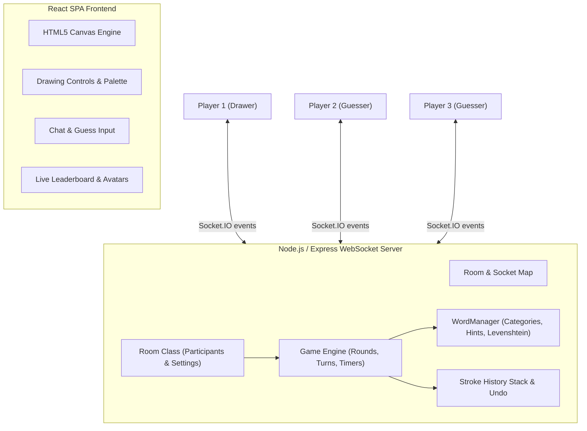

# Skribbl.io Clone — Full-Stack Multiplayer Drawing & Guessing Game

An end-to-end, real-time multiplayer drawing and guessing game built with **React**, **Node.js/Express**, and **Socket.IO**. Designed with clean Object-Oriented Architecture (OOP) and responsive canvas graphics.

---

## 🎮 Features

### 1. Room & Lobby Management
- **Create Room**: Host can customize room settings:
  - **Player Capacity**: 2–20 players
  - **Draw Time**: 15–240 seconds per turn
  - **Rounds**: 2–10 rounds
  - **Word Choices**: 1–5 choices offered to drawer
  - **Hints Count**: 0–5 hints revealed over time
  - **Word Categories**: All, Animals, Food & Drinks, Everyday Objects, Actions/Verbs, Nature & Places
  - **Custom Words**: Host can provide custom comma-separated words
  - **Word Mode**: Normal (shows blanks and hints) or Hidden
  - **Privacy**: Public or Invite-Only Private rooms
- **Join Room**:
  - Join via Room Code or direct invite link (`/game/:roomId` or `?room=CODE`)
  - Open public rooms list with live player counts and one-click join
- **Interactive Avatar Customizer**:
  - Customize avatar color, eyes (normal, happy, wink, cool sunglasses), and mouth (smile, grin, O-shape, neutral)
- **Lobby Controls**:
  - Host indicator (👑), 1-click **Copy Invite Link**, **Start Game** (supports solo practice and multiplayer), and **Open 2nd Player Window** button for easy local testing.

### 2. Turn-Based Game Engine & Real-Time Sync
- **Word Selection**: Drawer receives 1–5 randomized words from the chosen category with a 15-second countdown timer.
- **Drawing Canvas**:
  - High-performance HTML5 Canvas with normalized cross-resolution coordinates and touch support.
  - **24-Color Palette**: Full skribbl.io color range.
  - **4 Brush Sizes**: Thin, Medium, Thick, Chunky.
  - **Drawing Tools**: Brush / Pen, Eraser toggle, Undo last stroke, Clear entire canvas.
  - **Real-Time Stroke Sync**: Broadcasts strokes live to all players via WebSockets.
  - **Full Canvas History & Sync**: Newly connected or reconnecting players automatically receive the full drawing history.
- **Intelligent Guessing & Chat**:
  - Guess input validates against secret word (case-insensitive, trimmed, symbol-normalized).
  - **Close-Guess Detection**: Uses Levenshtein distance algorithm to privately alert guessers when their guess is 1 letter away ("💡 'aple' is very close!").
  - **Anti-Spoiler Chat**: Once a player guesses the word, their subsequent messages are visible only to others who have already guessed.
  - **Scoring System**: Points calculated dynamically based on remaining draw time, guess order rank, plus bonus points awarded to the drawer.
- **Progressive Hint System**:
  - Unrevealed letters in blanks (e.g. `_ _ a _ _`) are revealed automatically at calculated intervals throughout the turn.
- **Round Recap & Podium**:
  - End of round displays the secret word and points breakdown.
  - Game Over screen displays a 1st, 2nd, and 3rd place podium with final scores, and host "Play Again" button.
- **Moderation**:
  - Host kick (`👢 Kick Player`) and community votekick (`⚠️ Vote to Kick`).

---

## 🏛️ Architecture Overview



### WebSocket Protocol Specification

| Category | Event Name | Direction | Payload | Description |
| :--- | :--- | :--- | :--- | :--- |
| **Room & Lobby** | `create_room` | Client &rarr; Server | `{ roomId, hostName, settings, avatar, isPrivate }` | Creates room with settings |
| | `join_room` | Client &rarr; Server | `{ roomId, playerName, avatar }` | Joins existing room |
| | `join_success` | Server &rarr; Client | `{ roomId, player, players, settings, isHost }` | Confirms room entry |
| | `player_joined` | Server &rarr; Clients | `{ player, players }` | Broadcasts new participant |
| | `player_left` | Server &rarr; Clients | `{ playerId, players }` | Broadcasts departure |
| | `start_game` | Client &rarr; Server | `{ roomId }` | Host starts the game |
| **Game Flow** | `round_start` | Server &rarr; Clients | `{ round, maxRounds, drawerId, drawerName, drawTime }` | New round begins |
| | `word_options` | Server &rarr; Drawer | `{ words, timeLimit }` | Delivers word choices |
| | `select_word` | Drawer &rarr; Server | `{ roomId, word }` | Drawer selects word |
| | `game_state` | Server &rarr; Clients | `{ status, round, drawerId, wordHint, timeLeft }` | Syncs active state |
| | `hint_update` | Server &rarr; Clients | `{ wordHint }` | Broadcasts newly revealed letter hint |
| | `round_end` | Server &rarr; Clients | `{ word, reason, players }` | Round recap |
| | `game_over` | Server &rarr; Clients | `{ winner, leaderboard }` | Game finished & podium |
| **Drawing** | `draw_start` | Drawer &rarr; Server | `{ roomId, x, y, color, size, isEraser }` | Starts new stroke |
| | `draw_move` | Drawer &rarr; Server | `{ roomId, x, y }` | Continues stroke |
| | `draw_end` | Drawer &rarr; Server | `{ roomId }` | Ends stroke |
| | `draw_undo` | Drawer &rarr; Server | `{ roomId }` | Undos last stroke from stack |
| | `canvas_sync` | Server &rarr; Clients | `{ strokes }` | Broadcasts updated canvas stroke stack |
| | `clear_canvas` | Drawer &rarr; Server | `{ roomId }` | Clears canvas |
| **Chat & Guesses** | `send_message` | Client &rarr; Server | `{ roomId, author, message }` | Sends guess or message |
| | `receive_message` | Server &rarr; Clients | `{ author, message, isSystem, isCorrectGuess, isClose }` | Delivers guess results |
| | `guess_result` | Server &rarr; Clients | `{ correct, playerId, playerName, points }` | Broadcasts points earned |

---

## 🚀 Setup & Local Execution

### Prerequisites
- **Node.js** (v18+)
- **npm** (v9+)

### Installation
1. Install backend dependencies:
   ```bash
   cd backend
   npm install
   ```

2. Install frontend dependencies:
   ```bash
   cd ../frontend
   npm install
   ```

### Running the App
- **Option 1: Development Mode (React Hot Reload + Backend)**:
  - Terminal 1 (Backend):
    ```bash
    cd backend
    node index.js
    ```
    *Runs on http://localhost:5000*
  - Terminal 2 (Frontend):
    ```bash
    cd frontend
    npm start
    ```
    *Opens on http://localhost:3000*

- **Option 2: Unified Production Mode (Single Port)**:
  - Build the frontend:
    ```bash
    cd frontend
    npm run build
    ```
  - Start the backend:
    ```bash
    cd ../backend
    node index.js
    ```
  - Open `http://localhost:5000` in your browser!

### Running Automated Test Suite
An automated end-to-end integration test is provided in `backend/test_flow.js`:
```bash
node backend/test_flow.js
```
Verifies word matching, close guess logic, canvas strokes, undo, hint masking, and score calculation.

---

## 🌐 Production Deployment Guide

### Deploying on Render / Railway (Recommended Full-Stack)
1. Set the root directory or service build command:
   ```bash
   cd frontend && npm install && npm run build && cd ../backend && npm install
   ```
2. Start command:
   ```bash
   node backend/index.js
   ```
3. Set Environment Variable:
   - `PORT`: `5000` (or platform default)
   - `NODE_ENV`: `production`

### Deploying Frontend on Vercel / Netlify + Backend on Render
1. Deploy `backend` on Render/Railway. Note the backend URL (e.g. `https://skribbl-clone-api.onrender.com`).
2. Deploy `frontend` on Vercel or Netlify.
3. In Vercel / Netlify environment variables, set:
   - `REACT_APP_SERVER_URL`: `https://skribbl-clone-api.onrender.com`
