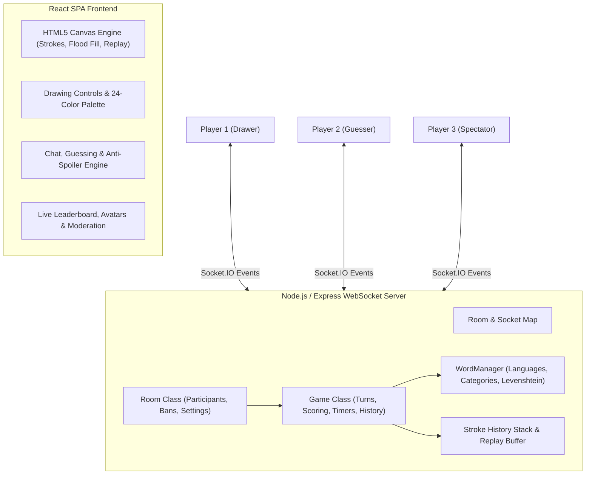

# Skribbl.io Clone — Full-Stack Real-Time Multiplayer Game

An end-to-end, feature-complete clone of **skribbl.io** built with **React**, **Node.js/Express**, and **Socket.IO**. Designed with an Object-Oriented Architecture (OOP), high-performance HTML5 Canvas engine, intelligent word guessing with Levenshtein distance, multi-language support, spectator mode, replay player, and responsive UI design.

---

## 🎮 Complete Feature Matrix (Assignment Checklist)

### ✅ Must Have (Core Functionality)
- [x] **Multiplayer Rooms**: Create and join rooms via 6-character code or 1-click invite link (`/game/:roomId` or `?room=CODE`).
- [x] **Configurable Room Settings**:
  - Max Players: 2–20 players
  - Rounds: 2–10 rounds
  - Draw Time: 15–240 seconds
  - Word Choices: 1–5 choices offered to drawer
  - Hints Count: 0–5 hints, or disabled
  - Word Categories: Animals, Food, Objects, Actions, Nature, or All
  - Word Modes: Normal, Hidden (`???`), and Combination (`flying car`, `space pizza`)
  - Multi-Language Dictionary: English 🇬🇧, Spanish 🇪🇸, German 🇩🇪, French 🇫🇷
  - Custom Words: Host-defined comma-separated words
  - Privacy: Public (open lobby listing) or Private (invite-only)
- [x] **Lobby & Ready-Up**: Live player list, player avatars, host crown 👑, interactive ready-up toggle (✓ Ready / ⏳ Waiting), and host game launch.
- [x] **Turn-Based Drawing & Rounds**: Rotates turns across all active players so everyone gets a turn to draw each round.
- [x] **Real-Time Canvas Drawing**: Sub-millisecond synchronized canvas drawing with cross-resolution coordinate normalization and touch support.
- [x] **Drawing Tools**:
  - ✏️ Brush / Pen
  - 🪣 Bucket Flood Fill (4-way scanline canvas algorithm)
  - 🧹 Eraser
  - 🎨 24-Color Palette (authentic skribbl.io range)
  - 📏 4 Brush Sizes (Thin, Medium, Thick, Chunky)
  - ↩️ Undo last stroke
  - 🗑️ Clear entire canvas (drawer only)
- [x] **Word Selection**: Drawer picks 1 of N words with 15s countdown timer (auto-picks if time expires).
- [x] **Guessing & Scoring**:
  - Live guess evaluation (case-insensitive, trimmed, symbol-normalized).
  - Progressive point awards based on remaining draw time, guess order rank, plus drawer bonus points.
  - Winner announcement and 1st, 2nd, 3rd place podium on game over.

### ✅ Should Have & Nice to Have
- [x] **Progressive Hint System**: Automatic letter reveals over time (e.g. `_ _ a _ _`) spaced evenly throughout turn duration.
- [x] **Anti-Spoiler Chat & Close-Guess Alerts**:
  - Messages from players who already guessed are hidden from pending guessers.
  - Levenshtein distance algorithm alerts guessers privately when their guess is 1 letter away ("💡 'aple' is very close!").
- [x] **Draw Time Countdown**: Animated navbar timer with urgent countdown alert when ≤ 15s.
- [x] **Moderation System**:
  - Host Kick (`👢 Kick Player`)
  - Host Ban (`🚫 Ban Player` — prevents rejoining room)
  - Community Votekick (`⚠️ Vote to Kick` — triggers when >50% vote)
  - Player Reporting (`🚩 Report Player`)

### 🌟 Bonus Features
- [x] **OOP Server Architecture**: Clear separation of concerns with `Room`, `Game`, `Player`, and `words` classes/modules.
- [x] **Word Modes**: Normal (reveals letters & length), Hidden (no length or hints), and Combination (2-word phrases).
- [x] **Custom Word Lists**: Host can supply custom vocabulary.
- [x] **Interactive Avatar Customizer**: 9 colors, 4 eye expressions (normal, happy, wink, cool sunglasses), and 4 mouth styles (smile, grin, O-shape, neutral).
- [x] **Spectator Mode**: Join or toggle into 👁️ Spectator Mode to watch without drawing or interfering with game rounds.
- [x] **Drawing Replay Engine**: Watch an animated stroke-by-stroke replay of the last round's drawing during round recap!

---

## 🏛️ Architecture Overview



---

## 📡 WebSocket Protocol Specification

| Event | Direction | Payload | Description |
| :--- | :--- | :--- | :--- |
| `create_room` | Client &rarr; Server | `{ hostName, settings, avatar, isPrivate, roomId }` | Creates room with configuration |
| `join_room` | Client &rarr; Server | `{ roomId, playerName, avatar, isSpectator }` | Joins room by code |
| `player_joined` | Server &rarr; Clients | `{ player, players }` | Broadcasts new participant |
| `player_left` | Server &rarr; Clients | `{ playerId, players }` | Broadcasts player departure |
| `toggle_ready` | Client &rarr; Server | `{}` | Toggles player ready-up status |
| `toggle_spectator` | Client &rarr; Server | `{}` | Toggles spectator mode |
| `start_game` | Client &rarr; Server | `{ roomId }` | Host starts the game |
| `game_state` | Server &rarr; Clients | `{ phase, round, drawerId, word, hints, timeLeft }` | Syncs current active game state |
| `round_start` | Server &rarr; Clients | `{ drawerId, wordOptions, drawTime, round, maxRounds }` | Begins round, sends words to drawer |
| `word_chosen` | Client &rarr; Server | `{ word, roomId }` | Drawer selects word to draw |
| `draw_start` | Client &rarr; Server | `{ x, y, color, size, isEraser }` | Drawer initiates stroke |
| `draw_move` | Client &rarr; Server | `{ x, y }` | Drawer appends points to stroke |
| `draw_end` | Client &rarr; Server | `{}` | Drawer finishes stroke |
| `draw_fill` | Client &rarr; Server | `{ x, y, color }` | Bucket flood fill command |
| `draw_data` | Server &rarr; Clients | `{ type, ...stroke }` | Broadcasts stroke data for drawing sync |
| `draw_undo` | Client &rarr; Server | `{}` | Drawer undos last stroke |
| `canvas_clear` | Client &rarr; Server | `{}` | Drawer clears canvas |
| `guess` | Client &rarr; Server | `{ text }` | Guesser sends word guess |
| `guess_result` | Server &rarr; Clients | `{ correct, playerId, playerName, points }` | Broadcasts guess outcome & points |
| `chat` | Client &rarr; Server | `{ text }` | Player sends general chat |
| `chat_message` | Server &rarr; Clients | `{ playerId, playerName, text }` | Broadcasts chat message |
| `round_end` | Server &rarr; Clients | `{ word, scores, nextDrawer, reason, players, hasReplay }` | Round recap & scores |
| `get_round_replay` | Client &rarr; Server | `{}` | Requests stroke replay buffer |
| `round_replay` | Server &rarr; Client | `{ strokes }` | Delivers strokes for animated replay |
| `game_over` | Server &rarr; Clients | `{ winner, leaderboard }` | Game finished & podium |
| `ban_player` | Client &rarr; Server | `{ targetId }` | Host bans player from room |
| `kick_player` | Client &rarr; Server | `{ targetId }` | Host kicks player from room |
| `vote_kick` | Client &rarr; Server | `{ targetId }` | Community votekick |
| `report_player` | Client &rarr; Server | `{ targetId, reason }` | Player reporting |

---

## 💡 Code Understanding & Technical Walkthrough

### 1. How drawing strokes are captured, sent, and rendered across clients
- **Capture**: The drawing canvas uses a virtual coordinate system of **800×500**. Mouse and touch event coordinates (`clientX`, `clientY`) are scaled relative to `canvas.getBoundingClientRect()` using `scaleX = canvas.width / rect.width` and `scaleY = canvas.height / rect.height`. This guarantees 1:1 pixel accuracy across phones, tablets, and high-DPI monitors.
- **Transmission**: Strokes emit `draw_start` with initial `(x, y, color, size, isEraser)` when mouse goes down, followed by throttled `draw_move` `(x, y)` points, and `draw_end`. A dedicated `draw_fill` event transmits `(x, y, color)` for the bucket tool.
- **Rendering & Synchronization**: On other clients, strokes are rendered using standard HTML5 Canvas 2D context path methods (`beginPath`, `moveTo`, `lineTo`, `stroke`). The server stores the full stroke history in memory (`room.game.strokes`). When a new user connects or reconnects, the server emits `canvas_sync` with the entire stroke stack to immediately restore the canvas state.

### 2. How game state (rounds, turn order, scoring) is managed
- Encapsulated in the `Game` class (`backend/utils/game.js`).
- **Turn Order**: Active non-spectator players form the `drawerOrder` array. An index pointer `currentDrawerIndex` advances each turn. When all players have drawn, the round counter increments until `maxRounds` is reached.
- **Phase State Machine**: Transitions through `WAITING` &rarr; `CHOOSING` &rarr; `DRAWING` &rarr; `ROUND_END` &rarr; `GAME_OVER`.
- **Scoring Algorithm**:
  $$\text{Points} = \max\left(50, 200 + \left\lfloor\frac{T_{\text{left}}}{T_{\text{total}}} \times 300\right\rfloor + \text{RankBonus}\right)$$
  - First guesser gets $+50$ bonus, second gets $+25$.
  - Drawer earns a $+35\%$ bonus each time a guesser succeeds, incentivizing clear drawings.

### 3. How WebSockets are used for real-time sync
- WebSockets via **Socket.IO** maintain full-duplex, low-latency communication over rooms partitioned by `roomId`.
- Sockets join room channels via `socket.join(roomId)`. Events can be sent to the entire room (`io.to(roomId).emit`), the room excluding the sender (`socket.broadcast.to(roomId).emit`), or a specific socket ID (`io.to(socketId).emit`).
- Heartbeat pings and automatic reconnections (`reconnectionDelay: 1000`) handle intermittent network drops gracefully.

### 4. Word-matching logic (case, trim, partial/close-guess)
- **Normalization**: Input is trimmed, lowercased, and stripped of non-alphanumeric symbols via regex `/[^a-z0-9 ]/gi`.
- **Exact Match**: If normalized guess equals secret word, `handleGuess()` awards points and alerts the room without displaying the word in chat (anti-spoiler).
- **Close-Guess Detection**: Uses dynamic programming **Levenshtein Distance** matrix:
  - If distance is $\le 1$ (or $\le 2$ for words $>6$ characters), the guesser receives a private system hint: `💡 'aple' is very close!`.
  - Drawer messages are prevented from guessing during their turn to avoid accidental spoilers.

### 5. Deployment setup & platform constraints
- **Single-Service Full-Stack (Render / Railway)**: The Express backend serves the static React production build from `frontend/build` and attaches Socket.IO to the same HTTP server on port 5000. WebSockets work natively with zero configuration.
- **Separated Frontend + Backend (Vercel / Netlify + Render)**: Vercel/Netlify host serverless frontend assets. WebSockets cannot run on Vercel serverless functions (which are ephemeral HTTP lambdas). Hence, the WebSocket server is hosted on Render/Railway, and the frontend connects via `REACT_APP_SERVER_URL`.

---

## 🚀 Setup & Local Execution

### Prerequisites
- **Node.js** (v18+)
- **npm** (v9+)

### Installation
1. Install backend dependencies:
   ```bash
   cd backend
   npm install
   ```

2. Install frontend dependencies:
   ```bash
   cd ../frontend
   npm install
   ```

### Running Locally
- **Option 1: Development Mode**:
  - Terminal 1 (Backend):
    ```bash
    cd backend
    node index.js
    ```
    *Backend runs on http://localhost:5000*
  - Terminal 2 (Frontend):
    ```bash
    cd frontend
    npm start
    ```
    *Frontend runs on http://localhost:3000*

- **Option 2: Unified Production Mode (Single Port)**:
  ```bash
  cd frontend && npm run build && cd ../backend && node index.js
  ```
  *Open http://localhost:5000 in your browser!*

### Running Automated Test Suite
```bash
node backend/test_flow.js
```
Runs the automated test suite testing word matching, Levenshtein distance, multi-language dictionaries, combination mode, WebSocket lifecycle, drawing sync, flood fill, undo, close guess, anti-spoiler chat, spectator mode, ready-up, ban moderation, and replay buffer.

---

## 🌐 Production Deployment Guide

### Deploying on Render / Railway (Recommended Full-Stack)
1. Repository: Link your GitHub repository.
2. Build Command:
   ```bash
   cd frontend && npm install && npm run build && cd ../backend && npm install
   ```
3. Start Command:
   ```bash
   node backend/index.js
   ```
4. Environment Variables:
   - `PORT`: `5000` (or platform default)
   - `NODE_ENV`: `production`

**Live Production URL:**
`https://your-skribbl-clone.onrender.com` (Update with your live deployment URL)
